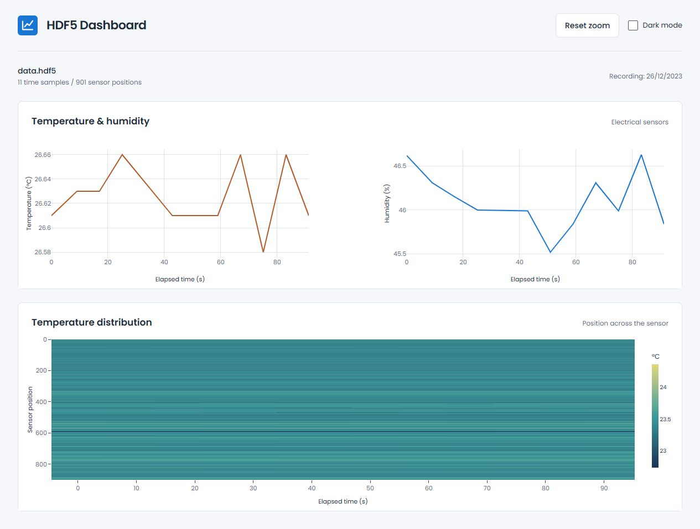
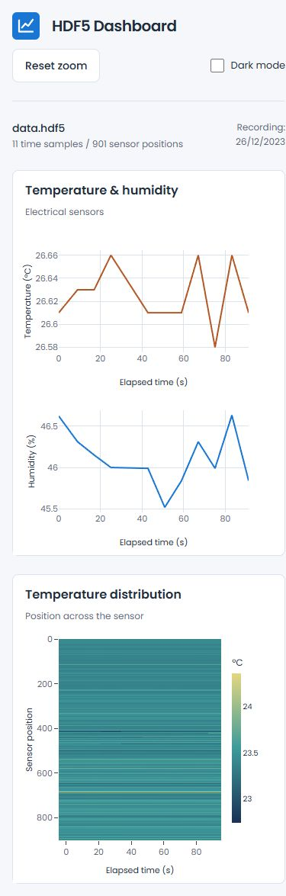

<h1><picture><source media="(prefers-color-scheme: dark)" srcset="docs/logo-dark.svg"></picture></h1>

A dashboard for viewing temperature and humidity recordings from an HDF5 file. Flask reads the datasets; the frontend plots the electrical sensors and temperature across the full sensor length.

<picture>
  <source media="(prefers-color-scheme: dark)" srcset="docs/dark.jpg">
  
</picture>

<details>
<summary>Mobile view</summary>
<br>

</details>

## Features

- Separate temperature and humidity plots with recorded elapsed time.
- Temperature heatmap across every position in the dataset.
- Chart zoom, hover values, and reset controls.
- Responsive layout, Poppins typography, and saved light or dark mode.

The included `api/data.hdf5` recording has 11 time samples and 901 sensor positions. Screenshots show this file.

## Run locally

Node.js 22.12+ and Python 3.13.

On Windows:

```sh
npm ci
npm run setup:api
npm start
```

Open `http://localhost:5173`. The frontend proxies `/api/` to Flask on port 5008.

On macOS or Linux, create a virtual environment, install `api/requirements.txt`, and run these in separate terminals:

```sh
python -m flask --app api.main run --port 5008
npm run start:frontend
```

Activate the Python environment before starting Flask. `VITE_API_URL` can point the frontend at a separately hosted API.

```sh
npm test
npm run build
```

Built with Flask, h5py, NumPy, JavaScript, Plotly and Vite.
