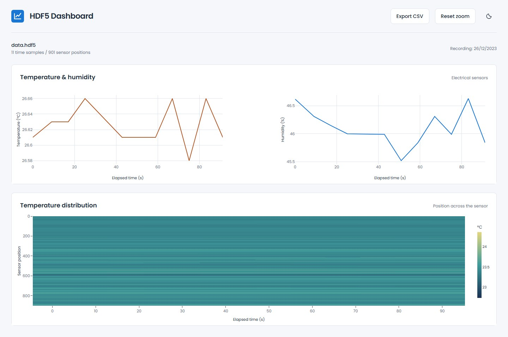

# HDF5 Dashboard

Inspect temperature and humidity recordings alongside a heatmap of every sensor position. Zoom into a recording and export the full dataset as CSV.



## Setup

Node.js 22.12+ and Python 3.13. Windows, macOS, or Linux.

```sh
npm ci
npm run setup:api
npm start
```

Open http://localhost:5173. Includes an HDF5 recording with 11 time samples and 901 sensor positions. Flask runs on port 5008.

Flask · h5py · NumPy · Plotly · Vite. [Development notes](docs/development.md).
